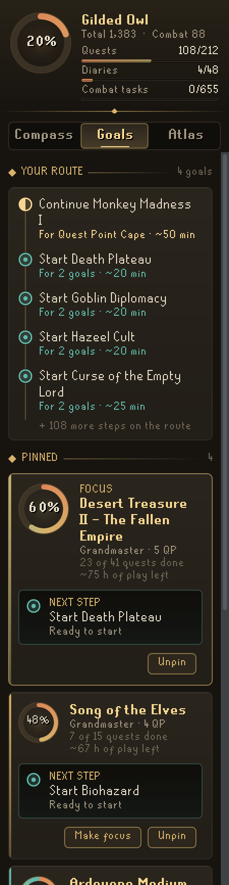
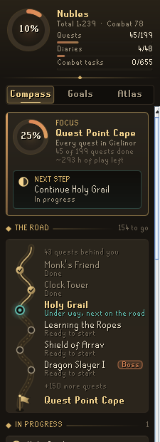
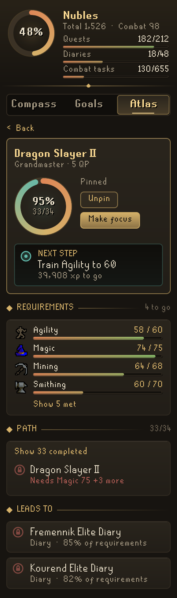
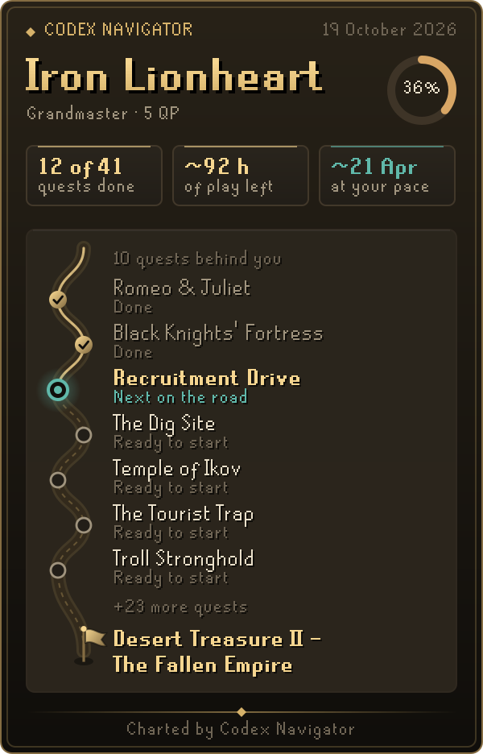

# Codex Navigator

**An account compass for Old School RuneScape.** Pin anything you want to reach (a quest, a diary tier, the quest cape or a level) and Codex Navigator charts the whole way there from your real progress, prerequisites first, down to the single next step and about how much play is left.

Part of the **Codex** suite of RuneLite plugins, which share one look: warm ink, aged gold and the game's own fonts.

<p align="center">
  
  
  
</p>

## The panel

- **Crest.** One ring for your whole account, with ledgers for the quest cape (counted as the cape counts quests), diaries and combat achievement tasks.
- **Compass.** Your focus goal and its next step, then quests in progress, the **best next** quests (those on the way to your goals first, then by how much each opens per hour), quests you can start today with a pie or potion (**Boost and go**), quests held back by only a little training (**Almost there**), the diary tiers within reach and how fast you really train.
- **The road.** Under your focus, the way there drawn as a road on an old map: every quest a stone, gold behind you, a glowing stone for the next one and a flag at the goal. Click a stone to open its quest. **Save road card** or **Copy** makes a picture of it to share.
- **Goals.** Pin any quest, diary tier, the quest cape or a level. The first pin is your focus. Each goal shows its progress, next step and the play left. A finished goal tells you in the chatbox and offers the next in line to pin. With several goals pinned, their paths merge into one route, shared steps once. **Next session** fills one to four hours from your goals.
- **Level goals.** "Aiming for a level?" opens a skill grid that offers the levels worth aiming for: the next ones that open a quest or diary tier, the next round ten, and 99.
- **Atlas.** Search and filter every quest, see each area's diary tiers as seals, and track combat achievement tiers.
- **Path pages.** Open any goal for every level, quest point and combat level it still needs, every quest on the way as a timeline (done, in progress, ready, or blocked and by what), and what finishing it leads to.
- **Your pace.** Navigator learns how fast you really train each skill from the experience you gain while it runs, and times every estimate with it.
- **In-game plaque.** A small overlay with your focus and its next step; with nothing pinned it suggests the best quest to start.

<p align="center">
  
  
  
</p>

<p align="center">
  
  
</p>

## Good to know

- **Diaries.** The game tells plugins which diary tiers are complete, not which of their tasks you have done. Once every level and quest a tier needs is met, Navigator says **Tasks** rather than a percentage it cannot measure.
- **Free worlds.** On a free world only free quests are suggested and diaries are left out.
- **Time estimates.** Times assume steady, ordinary training and a typical first play-through of each quest, until Navigator has seen 15 minutes of your own training in a skill. They are for comparing one choice with another, so they read as "about".
- **Boosts.** A level counts as boostable only where Quest Helper marks it so, and only for plain, repeatable boosts (pies, potions, the dwarven stout). Ironmen are only offered boosts they can make or buy in a shop.
- **Logged out.** Goals you pin while logged out join your account's goals at your next login.

## Settings that matter

| Setting | Default | What it does |
| --- | --- | --- |
| Show focus in game | On | The in-game plaque with your focus and its next step. |
| Suggest with no focus | On | With nothing pinned, the plaque suggests the best quest to start. |
| Announce finished goals | On | A chatbox line, seen only by you, the moment a pinned goal is complete. |
| Include miniquests | On | Lists and suggests miniquests alongside quests. |
| Learn my pace | On | Times training by how fast you really train each skill. Off uses steady rates. |
| Hardcore care | On | On a one-life account, marks quests with a deadly fight or a Wilderness trip and suggests them after safer ones. |
| Name on cards | On | Your character's name on the road card. |

## With other Codex plugins

Navigator works on its own. With these installed it knows more, and only ever reads what they save:

- **[Codex Session Chronicle](https://github.com/Nubles/OSRS-Codex-Session-Chronicle):** how much you have played over the last two weeks, which turns each goal's hours into a day on the calendar ("Around 3 Nov at your 40 min a day"). Without it, no dates are shown.
- **[Codex Guardian](https://github.com/Nubles/OSRS-Codex-Guardian):** an account you marked one-life there gets Hardcore care, as hardcore ironmen and Hardcore World accounts do anyway.

Your pinned goals are shared the other way: Bank Steward, Annals, Plunder Pilot, Pest Control Pilot and Minigame Pilot read them to point their own suggestions at what you are working toward.

## Privacy and rules

Navigator only reads what the client already shows you (quest states, diary and combat achievement progress, levels) and draws its own panel and overlay. It does not click, change menus, send chat or touch the network; its one chatbox line is seen only by you. Pinned goals and your learned pace are saved per account in your RuneLite profile and never leave your computer. A damaged save loses only the entries that cannot be read, and a save it can read only in part (damaged, or from a newer version) is copied aside unchanged before anything is saved over it.

## For other plugins

Codex Navigator saves two keys per RuneScape profile in the `codexnavigator` config group, which any plugin can read with `ConfigManager.getRSProfileConfiguration("codexnavigator", key)`. Both shapes are stable: fields may be added, never renamed or removed.

- **`goals`**: the pinned goals in order, focus first, as a JSON list of keys: `"quest:<name>"` (names as in RuneLite's `Quest` enum), `"diary:<Area> <Tier>"` such as `"diary:Ardougne Easy"`, `"cape:Quest point cape"`, and `"skill:<Skill> <level>"` such as `"skill:Agility 70"`. Readers should keep keys of a kind they do not know.
- **`goalBoard`**: the same goals with what they still need, written whenever that changes while logged in:

```json
{
  "version": 1,
  "focus": "quest:Regicide",
  "goals": [
    {
      "key": "quest:Regicide",
      "type": "quest",
      "title": "Regicide",
      "complete": false,
      "progress": 0.42,
      "next": "Start Plague City",
      "hoursLeft": 4.5,
      "skills": { "Agility": 56, "Ranged": 25 },
      "quests": ["Plague City", "Biohazard", "Underground Pass", "Regicide"]
    }
  ]
}
```

`type` is `quest`, `diary`, `cape` or `skill` (a level goal: its `skills` holds the one level, its `quests` is empty). `skills` lists only unmet levels, by skill name. `quests` lists unfinished quests on the way, prerequisites first. `progress` is rounded to two decimals and `hoursLeft` to the half hour. `next` is absent once a goal is complete, and `focus` is absent with nothing pinned.

## Data

Quest and diary requirements are bundled in `src/main/resources/com/codex/navigator/codex-data.json`. They are generated from the [Fate Locked](https://github.com/Nubles/OSRS-Fate-Locked) dataset, with names mapped to RuneLite's `Quest` enum so progress can be read from the game. To regenerate the data, see `tools/build-codex-data.py`.

Which skill requirements can be boosted comes from [Quest Helper](https://github.com/Zoinkwiz/quest-helper) (BSD 2-Clause, see `THIRD_PARTY_NOTICES.md`) and is bundled as `boosts.json`; `tools/build-boosts.py` rebuilds it.

## Development

```bash
./gradlew build   # compile and run tests
./gradlew run     # launch RuneLite with the plugin loaded
```

The `docs/screenshots` images are rendered from the real panel code with a sample account.
