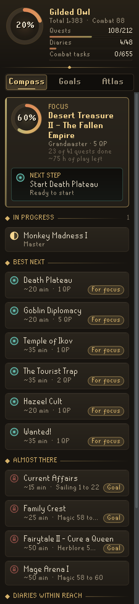
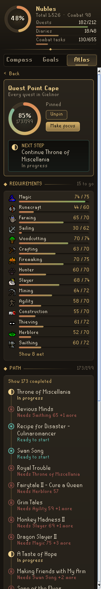
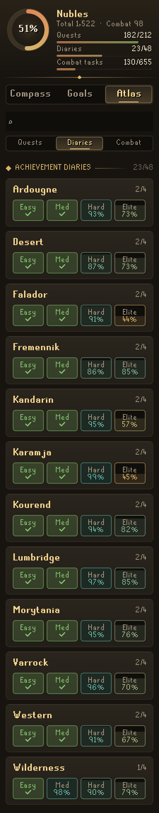
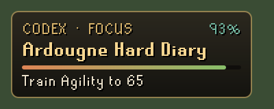

# Codex Navigator

**An account compass for Old School RuneScape.** Codex Navigator reads your quests, achievement diaries, levels and combat achievement progress straight from the client. Pin anything you want to reach and it charts the whole path there, prerequisites first, down to the single next step.

It is the first plugin in the **Codex** suite: a family of RuneLite plugins that share one design language and one local account core.

<p align="center">
  
  
  
</p>

## What it does

- **Account crest.** One ring for your whole account, plus ledgers for quests, diaries and combat achievement tasks.
- **Compass.** Your focus goal and its next step, then quests in progress, the **best next** quests and the quests held back by only a little training. Best next puts the quests on the way to your focus first, then those on the way to your other goals, then the rest by how much they open per hour. Every suggestion says about how long it takes.
- **Goals.** Pin any quest, diary tier, the quest cape or a level. The first pin is your focus; every goal shows its progress, its next step and about how much play is left. Finished goals move to a Completed list, a line in your chatbox tells you the moment one is done, and each offers the **next in line** (the next diary tier, or the quest it leads into) to pin with one click.
- **Level goals.** "Aiming for a level?" on the Goals tab opens a skill grid; pick a skill and the Codex offers the levels worth aiming for: the next ones that open a quest or diary tier (in teal, with how many), the next round ten, and 99. A level goal's page lists everything it opens in level order, and whether anything else still holds each quest back. When you reach it, the next round ten is offered to pin.
- **A date on every goal.** With Codex Session Chronicle installed, the Codex reads how much you have played over the last two weeks and turns each goal's hours of play into a day on the calendar ("Around 3 Nov at your 40 min a day"). Without Chronicle, or with fewer than two sessions in its journal, no date is shown.
- **Next session.** Pick one to four hours and the Codex fills them from your goals: whole quests and levels first, then training for whatever time is left, each step unlocking the next. Under the plan, every goal shows how far the session moves it ("Regicide 62% to 81%").
- **Boost and go.** Quests you can start today with a pie or a potion: held back only by levels that the quest lets you boost, each within reach of an everyday boost ("Summer pie for Agility 56"). Path pages mark those levels in teal, and they cost no training time in any estimate.
- **Your pace.** The Codex learns how fast you really train each skill from the experience you gain while it runs, and times every estimate with it. The Compass lists what it has learned ("Agility · 38% faster · from 3.4 h").
- **Your route.** With two or more goals pinned, their paths are laid over one another into a single route. A quest or level that several goals share appears once, and the steps that move the most goals for the least time come first.
- **Atlas.** Search and filter every quest, see each area's diary tiers as seals, and track combat achievement tiers.
- **Path pages.** Open any goal to see every level, quest point and combat level it still needs with live bars, every quest on the way as a timeline (done, in progress, ready, or blocked and by what), and for a quest, what finishing it leads to.
- **Hardcore care.** On a one-life account (a hardcore ironman, any account on a Hardcore World, or one marked one-life in [Codex Guardian](https://github.com/Nubles/OSRS-Codex-Guardian)), quests with a fight hardcore players prepare for, or a trip into the Wilderness, are marked "Boss" or "Wildy" and suggested after the safer quests in the same group. A quest you pinned yourself is a risk you chose and keeps its place. A quest's page says what the danger is ("Elvarg breathes dragonfire: bring an anti-dragon shield"), for every account; a longer goal such as the quest cape lists the risky quests still on its path. The list is short on purpose: only quests whose danger is well known.
- **In-game plaque.** A small overlay with your focus and its next step. With nothing pinned it suggests the best quest to start.

### Good to know

- **Diaries.** The client tells the Codex which diary tiers are complete, but not which of their tasks you have done. Once every level and quest a tier needs is met, the Codex says **Tasks** rather than showing a 99% it cannot measure.
- **Free worlds.** On a free-to-play world, only free quests are suggested and diaries are left out, since they cannot be started there.
- **Time estimates.** Times assume steady, ordinary training methods and a typical first play-through of each quest, until the Codex has seen at least 15 minutes of your own training in a skill; then they move toward your pace over the first hour. Breaks, quest rewards and lamps are not counted as training. They are there to compare one choice with another, so they read as "about".
- **Boosts.** A level counts as boostable only where Quest Helper marks the requirement as boostable, and only for skills with a plain, repeatable boost: pies, potions and the dwarven stout. Ironmen are only offered a boost they can make themselves (a summer pie needs 95 Cooking) or buy in a shop (dwarven stout). Boost when the quest asks for the level; some quests check it at the start, others part-way through.
- **Dates.** A date assumes your play goes to that goal, at the daily average of your sessions in the last 14 days (counted over at least a week, so one long evening is not a habit). Chronicle's journal is only read, never written.
- **Logged out.** Goals you pin while logged out are added to your account's goals when you next log in.

<p align="center">
  
</p>

## Rules posture

Codex Navigator only reads client state you can already see (quest states, varbits, levels) and draws its own panel and overlay. It does not click, move items, change menus, send chat messages or touch the network; the only thing it writes to the chatbox is an optional line that only you can see. Nothing leaves your computer, and pinned goals and your learned pace are saved per account (and per game mode, such as Leagues) in your RuneLite profile.

## For other plugins

Codex Navigator saves two keys per RuneScape profile in the `codexnavigator` config group, which any plugin can read with `ConfigManager.getRSProfileConfiguration("codexnavigator", key)`. Both shapes are stable: fields may be added, never renamed or removed.

- **`goals`**: the pinned goals in order, focus first, as a JSON list of keys: `"quest:<name>"` (names as in RuneLite's `Quest` enum), `"diary:<Area> <Tier>"` such as `"diary:Ardougne Easy"`, `"cape:Quest point cape"`, and `"skill:<Skill> <level>"` such as `"skill:Agility 70"`. Readers should keep keys of a kind they do not know.
- **`goalBoard`**: the same goals with what they still need, written whenever that changes while logged in:

```json
{
  "version": 1,
  "focus": "quest:Regicide",
  "goals": [
    {
      "key": "quest:Regicide",
      "type": "quest",
      "title": "Regicide",
      "complete": false,
      "progress": 0.42,
      "next": "Start Plague City",
      "hoursLeft": 4.5,
      "skills": { "Agility": 56, "Ranged": 25 },
      "quests": ["Plague City", "Biohazard", "Underground Pass", "Regicide"]
    }
  ]
}
```

`type` is `quest`, `diary`, `cape` or `skill` (a level goal: its `skills` holds the one level, its `quests` is empty). `skills` lists only unmet levels, by skill name. `quests` lists unfinished quests on the way, prerequisites first. `progress` is rounded to two decimals and `hoursLeft` to the half hour. `next` is absent once a goal is complete, and `focus` is absent with nothing pinned.

## Settings

| Setting | Default | What it does |
| --- | --- | --- |
| Show focus in game | On | The in-game plaque with your focus and its next step. |
| Suggest when unfocused | On | With nothing pinned, the plaque suggests the best quest to start. |
| Include miniquests | On | Lists and suggests miniquests alongside quests. |
| Announce finished goals | On | A chatbox line the moment a pinned goal is complete. |
| Learn my pace | On | Times training by how fast you really train each skill. Off uses the steady rates. |
| Hardcore care | On | On a one-life account, marks quests with a deadly fight or a Wilderness trip and suggests them after safer ones. |

## Data

Quest and diary requirements are bundled in `src/main/resources/com/codex/navigator/codex-data.json`. They are generated from the [Fate Locked](https://github.com/Nubles/OSRS-Fate-Locked) dataset, with names mapped to RuneLite's `Quest` enum so progress can be read from the game. To regenerate the data, see `tools/build-codex-data.py`.

Which skill requirements can be boosted comes from [Quest Helper](https://github.com/Zoinkwiz/quest-helper) (BSD 2-Clause, see `THIRD_PARTY_NOTICES.md`) and is bundled as `boosts.json`; `tools/build-boosts.py` rebuilds it.

## Development

```bash
./gradlew build   # compile and run tests
./gradlew run     # launch RuneLite with the plugin loaded
```

The `docs/screenshots` images are rendered from the real panel code with a sample account.
